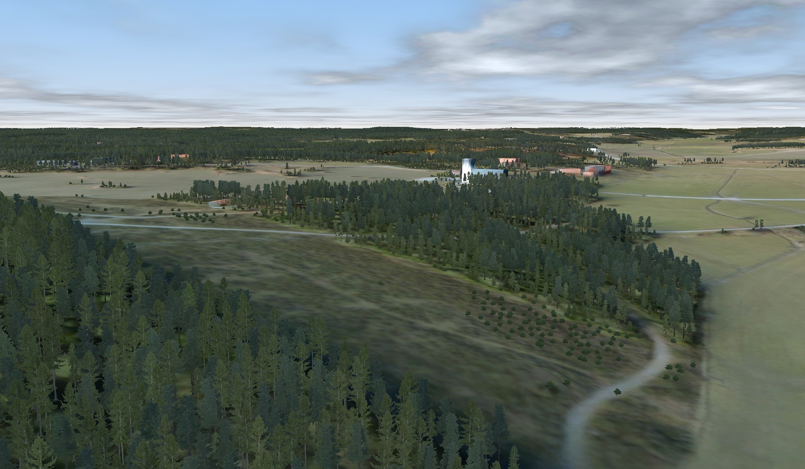

# CSWUnity

CSWUnity is the Unity-based viewer and Presentation realization of the
[Common Synthetic World (CSW)](https://saab.ghe.com/saab/CSW) architecture. It
combines Unity runtime components with the managed CSW SceneManager and the
managed/native GizmoSDK dependency graph.

## Purpose

CSW is an engine-independent architecture for representing and operating a
shared synthetic world. CSWUnity is one engine-specific part of that
architecture: it realizes the CSW Presentation capability in Unity, in
parallel with the CSWUnreal viewer for Unreal Engine.

The purpose of CSWUnity is to present terrain and geospatial content, dynamic
entities, and environmental state as a synthetic representation of the world.
The wider CSW architecture covers concepts such as vegetation, weather, wind,
water, controlled time, and time of day. Their availability in CSWUnity
depends on the feature modules and platform capabilities included in a given
configuration.



*Example of a CSW synthetic-world map presentation in CSWUnity (Unity).*

## Naming and migration

The reusable Unity package is `com.saab.csw` in the `com.saab.csw` folder.
The existing implementation and example-project paths retain the established
**Map Streamer** and `com.saab.map-streamer` names for compatibility.

Three names are used (REQ-CSW-TERM-001):

- **StreamingMap** is the CSW technology of streaming maps, which provides the
  synthetic world with map data.
- **`CSW.Unity.StreamingMap`** is the API through which CSWUnity exposes
  StreamingMap in Unity (REQ-CSWU-PKG-010).
- **CSWUnity** is the project that encapsulates everything: the `com.saab.csw`
  package with the StreamingMap API, the other Unity classes, utilities, tests,
  the example project, and the documentation.

StreamingMap replaces the earlier working name **CSW Map Streamer**
(`csw-map-streamer`). The transition is incremental: new documentation and
components use the StreamingMap name, while the example-project path
`projects/com.saab.map-streamer` remains unchanged until a separately planned
migration. The streaming component is `CSW.Unity.MapControl`.

In code, the folder and the namespace carry the CSW name. Code that uses the
CSW SceneManager is in `com.saab.csw/Runtime/CSW.Unity.StreamingMap` and the
`CSW.Unity.StreamingMap` namespace, in the subfolders `Commands`,
`Coordinates`, `Diagnostics`, `Scene`, `Interop`, and `Modules`, and its tests
are in the `StreamingMap` test folders. The GizmoSDK-to-Unity builders and
managers are in `com.saab.csw/Runtime/CSW.Unity/Builders` and the `CSW.Unity`
namespace, and all tests are in `CSW.Unity.Tests`. The assemblies are
`CSW.Unity`, `CSW.Unity.StreamingMap.Interop`, `CSW.Unity.Tests`,
`CSW.Unity.Tests.PlayMode`, `CSW.Unity.Demo`, and `CSW.Unity.Demo.Editor`.

The target naming is set by REQ-CSW-API-001, REQ-CSW-API-005 to
REQ-CSW-API-007, REQ-CSWU-PKG-008, and REQ-CSWU-PKG-010: the StreamingMap API
is `CSW.Unity.StreamingMap.<ClassName>` in
`com.saab.csw/Runtime/CSW.Unity.StreamingMap`; engine-independent CSW classes are
`CSW.<ClassName>`, such as `CSW.Camera`; every other class coupled to Unity
is `CSW.Unity.<ClassName>` in `com.saab.csw/Runtime/CSW.Unity`, and the Unity
realization of a generic class keeps its simple name, such as `CSW.Unity.Window`
for `CSW.Window`; C# code specific to Unreal, if any, is `CSW.Unreal.<ClassName>`;
engine-independent utilities are `CSW.Utility.<ClassName>` in
`com.saab.csw/Runtime/CSW.Utility`; broader libraries are in `CSW.Foundation`
or `CSW.<LibName>`, and in `CSW.Unity.Foundation` or `CSW.Unity.<LibName>` when
they bind to the Unity API. Every namespace with a specific coupling to Unity
begins with `CSW.Unity`. `GfxCaps` has
been moved to `CSW.Utility` and `TextureUtility` to `CSW.Unity`;
`CSW.Unity.Conversion` replaces `UnityGizmoExtensions` and the axis mapping of
`SceneCoordinateContext.Axes`. The former `Saab.Foundation.Unity.MapStreamer` namespaces have
moved to `CSW.Unity.StreamingMap` and `CSW.Unity`, and the former
`Saab.Unity.Initializer` is replaced by `CSW.Unity.Platform` and its default
component `CSW.Unity.PlatformComponent`.

The repository contains:

- the reusable `com.saab.csw` Unity package;
- a Unity example and validation project;
- locked CSW/GizmoSDK dependency staging;
- runtime and editor tests;
- architecture, requirements, and integration documentation; and
- CDW installation guides.

## Setup baseline

The current Windows setup baseline is:

| Component | Version or target |
| --- | --- |
| Unity project | `6000.3.5f2` |
| CSW managed package | `CSW.SceneManager` `1.1.1.1` |
| GizmoSDK packages | `2.12.347.1` |
| Native target | Windows x64 Release |
| Staging tool | .NET 8-compatible SDK |

Exact NuGet versions and content hashes are committed in
[`build/nuget-staging/packages.lock.json`](build/nuget-staging/packages.lock.json).

## Quick start

1. Clone the repository.
2. Open PowerShell in the repository root.
3. Double-click the Windows setup:

   ```bat
   setup.bat
   ```

4. Add `projects\com.saab.map-streamer` to Unity Hub.
5. Open the project with the Unity version specified in
   `ProjectSettings\ProjectVersion.txt`.
6. Open `Assets\Scenes\ExampleScene.unity` and enter Play mode.

The example project already references the generated local package:

```text
artifacts\unity-packages\com.saab.csw.dependencies
```

Run the staging command before opening Unity after a fresh clone or after
changing dependency versions.

The setup launcher restores the locked dependency graph, generates the Unity
package, and verifies every owned file:

| Shell | Setup |
| --- | --- |
| Windows | Double-click `setup.bat` |
| Git Bash on Windows | Run `./setup.sh` |

The current dependency profile supports Windows x64. `setup.sh` therefore
rejects Linux and macOS until complete platform profiles are available.

The equivalent direct .NET commands remain available for build agents and
cross-platform development:

```powershell
dotnet run --project tools\CSWUnity.NuGetStager -- stage
dotnet run --project tools\CSWUnity.NuGetStager -- verify
dotnet run --project tools\CSWUnity.NuGetStager -- clean
```

## Dependency staging

`tools\CSWUnity.NuGetStager` is the only supported dependency-installation
path. It replaces the previous Visual Studio installer and DLL-copy scripts.

The stager:

- restores an exact locked NuGet graph;
- lets NuGet resolve the transitive package closure;
- materializes assets for each enabled runtime identifier;
- validates required managed assemblies and native libraries;
- verifies native processor architecture;
- places assets in a generated UPM package;
- generates deterministic Unity `PluginImporter` metadata;
- records installed, disabled, and unavailable platforms; and
- owns and verifies every generated file by SHA-256.

The generated package currently contains:

### Managed assemblies

- `SceneManager.dll`
- `GizmoBase.dll`
- `Gizmo3D.dll`
- `GizmoDistribution.dll`
- `Coordinate.dll`

### Windows x64 native libraries

- CSW SceneManager and bridge libraries;
- GizmoSDK Base, Graph, Image, Database, System, Distribution, and Coordinate
  libraries; and
- the corresponding native bridge libraries.

To remove only tool-owned generated output, run:

```powershell
dotnet run --project tools\CSWUnity.NuGetStager -- clean
```

The tool refuses to replace or clean an output containing modified or unowned
files.

## Platform profiles

Platform selection is declared in
[`build/nuget-staging/staging.json`](build/nuget-staging/staging.json).

| Platform | Current status | Reason |
| --- | --- | --- |
| Windows x64 | Installed and verified | Complete CSW and GizmoSDK NuGet closure |
| Android ARMv7 | Disabled | Complete CSW native closure is not published |
| Android ARM64 | Disabled | Complete CSW native closure is not published |
| Linux x64 | Disabled | GizmoSDK package family and complete CSW closure must be selected |
| Linux ARM64 | Disabled | GizmoSDK package family and complete CSW closure must be selected |
| macOS ARM64 | Disabled | Current NuGet coverage is incomplete |
| iOS ARM64 | Disabled | No complete NuGet/static-link consumption model is published |

An enabled required platform fails staging if any package or native asset is
missing. Missing dependencies are never silently skipped.

The effective supported set is the intersection of:

1. platforms enabled by the staging profile;
2. complete CSW package assets;
3. complete GizmoSDK package assets; and
4. Unity-supported build targets.

The generated `supported-platforms.json` records the result for each build.

## Validation

Run the staging-tool tests with:

```powershell
dotnet test tools\CSWUnity.NuGetStager.Tests\CSWUnity.NuGetStager.Tests.csproj --configuration Release
```

The Windows baseline has also been validated by:

- importing the generated package in Unity on Windows x64;
- confirming that Unity recognizes all 15 native plugins; and
- successfully initializing and uninitializing `GizmoBase`, `Gizmo3D`,
  `GizmoDistribution`, `Coordinate`, and `CSW.Platform`.

## Repository layout

```text
build\nuget-staging\                 Locked dependency project and profile
com.saab.csw\                        Reusable Unity package
docs\                                Requirements, designs, and how-to guides
projects\com.saab.map-streamer\      Unity example and validation project
tools\CSWUnity.NuGetStager\          NuGet-to-UPM staging tool
tools\CSWUnity.NuGetStager.Tests\    Staging-tool tests
tutorial\howto\                      CDW installation and demo guides
artifacts\                            Generated local output; not committed
```

## Documentation

- [Documentation index](docs/README.md)
- [Stage NuGet dependencies for Unity](docs/howto/stage-nuget-dependencies.md)
- [Integrate CSWUnity into a host project](docs/howto/integrate-into-host-project.md)
- [Removed legacy architecture](docs/design/current-architecture.md)
- [Next-generation architecture](docs/design/next-generation-architecture.md)
- [CDW installation](tutorial/howto/CDW_Installation.md)
- [CDW Map Streamer demo](tutorial/howto/CDW_map_streamer_DEMO.md)

## Demo controls

| Key | Action |
| --- | --- |
| `W`, `A`, `S`, `D` | Move |
| `Space`, `Ctrl` | Move vertically |
| Arrow keys | Rotate |
| `Shift` | Increase movement speed |

To fly the camera over the map without input, see *Run the Demo Flight* in the
[CDW Map Streamer demo](tutorial/howto/CDW_map_streamer_DEMO.md).

## Licensing and contact

The open source code and documentation in this repository are provided under
the repository's applicable LGPL terms. Saab-provided native binaries have
separate licensing terms.

For commercial use and licensing questions, contact:
`anders.moden@saabgroup.com`.
