# CSWUnity: loop, buffertar, builders och lås

**Diskussionsunderlag, 2026-10-26.** Beskriver command-lane i den nuvarande
arbetskopian, inklusive ändringen till inputbatch och `TryLockEdit(0)`.
Kamerans senaste renderpose presenteras som standard varje Unity-frame i den
committade scenreferensen. Valbart synkläge presenterar i stället bara den
fullbordade native-framens pose och projektion. Detta är inte ett
förslag om en ny geometribyggtråd.

Två saker måste hållas isär:

- **Vänta på ett lås:** huvudtråden står still tills någon annan släpper det.
  Normal asynkron Tick gör ett låsförsök utan väntetid och fortsätter en senare frame
  om SDK-låset är upptaget.
- **Hålla ett lås under arbete:** även ett omedelbart lyckat låsförsök kan följas
  av ett långt arbete. Synkront mesh-/texturbygge under editlåset finns kvar.
  Andra SDK-trådar kan då behöva vänta på Unity.

## 1. Färger och låstyper

| Markering | Betydelse |
| --- | --- |
| Röd | SDK:s **globala EDIT-lås**. Inte ett privat lås per buffert eller karta. |
| Lila | SDK:s **globala RENDER-lås** för native traversal/läsning. |
| Blå | Kort lokalt kölås för input, output eller managed inbox. |
| Grön | Unity-publicering utan att den här tråden håller SDK-låset. |
| Gul | Logisk avvaktan eller kvarvarande kostnad; inte automatiskt en blockerande väntan. |

`buffer.TryLockEdit(...)` går vidare till `gzNodeLock::tryLockEdit(...)`.
`GetCommand()` låser inte själv: det omgivande buffertlåset skyddar iteration,
läsning av SDK-data och frigöring av kommandots grafreferenser.

**Referensägande över trådgränsen:** native `cswCommandBuffer` och
`cswSceneCommand` måste använda SDK:ns `gzThreadSafeReference`. Dess korta
objektspecifika referenslås är inte grafens EDIT-/RENDER-lås. Inputköns mutex
skyddar inte Unitys efterföljande `Dispose` mot workerns refökning/minskning.
En gammal native implementation med vanlig `gzReference` gav tappade
referenser och native fast-fail under långkörning. Native core och bridge
måste därför byggas och konsumeras som ett matchande par med nya headers.
Trådsäkert referensägande gör inte buffertinnehåll eller SDK-noder låsfria.

## 2. Hela rundan mellan Unity och CSW

Det här diagrammet och nästa visar **standardläget**, med
`SynchronizeFrames = false`. Det valbara synkflödet beskrivs i avsnitt 4.1.

```mermaid
flowchart LR
    subgraph UNITY["Unity huvudtråd"]
        direction TB
        U0["Update<br/>input och kamerasnapshot"]
        U1["Pump<br/>poll av ägd outputbuffert"]
        U2["TryLockEdit(0)<br/>capture av begränsad slice"]
        U3["Unlock i finally<br/>sedan publicering"]
        U4["Matchad EndFrame<br/>commit av scen och kamerareferens"]
        U5["En inputbuffert<br/>Omni + Position + Settings + LOD + Refresh"]
        U6["LateUpdate<br/>senaste pose i committad referens + PostPresent"]
        U0 --> U1 --> U2 --> U3 --> U4 --> U5
        U3 --> U6
    end
    subgraph NATIVE["CSW-worker"]
        direction TB
        N0["Inputkö + en trigger<br/>AddCommandBuffer(buffer, true)"]
        N1["Vänta på inputevent<br/>inget SDK-lås under eventväntan"]
        N2["Poppa input<br/>pausa kölåset under bearbetning"]
        N3["Applicera kamera/settings<br/>SDK EDIT i respektive operation"]
        N4["Refresh: traversal och LOD<br/>SDK RENDER"]
        N5["Outputkö och dispatch<br/>pausa kölåset under callback"]
        N6["processCommandBufferOut<br/>SDK EDIT runt callback"]
        N0 --> N1 --> N2 --> N3 --> N4 --> N5 --> N6
        N6 --> N1
    end
    subgraph HANDOFF["Callback och managed inbox"]
        I0["Behåll den ägda bufferten<br/>kort inboxlås, ingen Unity-API"]
    end
    U5 --> N0
    N6 --> I0
    I0 -->|"senare Update"| U1
    classDef edit fill:#ffe8e8,stroke:#c62828,color:#111;
    classDef render fill:#efe5ff,stroke:#7c3aed,color:#111;
    classDef queue fill:#e6efff,stroke:#2563eb,color:#111;
    classDef publish fill:#e5f7eb,stroke:#15803d,color:#111;
    classDef pending fill:#fff4cc,stroke:#a16207,color:#111;
    class U2,N3,N6 edit;
    class N4 render;
    class U1,N0,N2,N5,I0 queue;
    class U3,U4,U6 publish;
    class N1 pending;
```

Diagrammet visar normalfallet där `EndFrame` nås. Om den inte nås behålls
`RefreshOutstanding`: Unity lämnar tillbaka kontrollen till spelarloopen utan
att skicka ytterligare en refresh.

Native laddartrådar kan också producera New/Update/Delete-arbete till
SceneManagers outputkö. I den undersökta native implementationen köar
`addCommandBufferOut()` bara resultatet; den metoden triggar inte inputeventet.
Workerloopen behandlar input och därefter output. Refreshtriggningen är därför
också viktig för det fortlöpande utbytet av laddarresultat.

## 3. Vad en Unity-Tick faktiskt gör

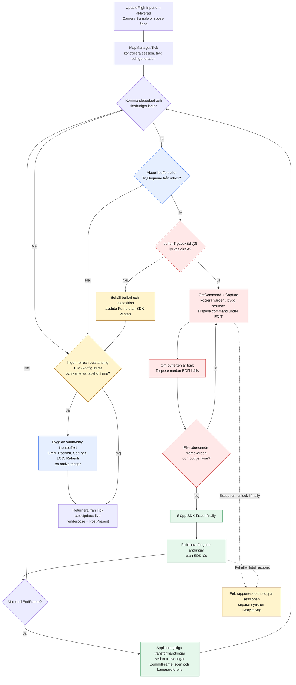

**Ordningsbarriärer:** New, full Update, Delete och GeoInfo publiceras innan
nästa beroende kommando fångas. Annars kan till exempel ett barns Capture
försöka använda en förälder som ännu inte registrerats. `EndFrame` är också en
barriär. Transform/Activation inom en frame kan däremot fångas tillsammans,
eftersom deras synliga ändringar ändå väntar på framecommit. Utanför en frame
publiceras dessa direkt mellan kommandona.

**Budgeten är inte en hård tidsgräns.** Ett påbörjat mesh-/texturbygge avbryts
inte när budgeten går ut. Den kontrolleras mellan kommandon, och atomisk
framecommit kan också kosta mer än den återstående budgeten.

## 4. Samma buffert över flera Unity-frames

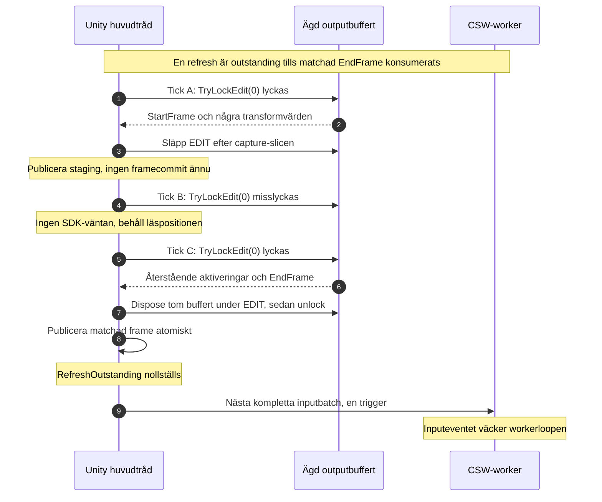

Det är **protokollstyrd backpressure**, inte att Unity gör `Wait()` på en frame.
Nativeworkern behöver inte få ett separat ackkommando: nästa refresh är det
fortsatta arbetet. Under tiden fortsätter Unity rendera senast committade
scen med den senaste kamerarotationen och förflyttningen. Input får inte vänta
på native `EndFrame`; en äldre frame får inte heller skriva tillbaka en äldre
renderpose.

### Renderpose och ROI-referens

ROI-transformer, terrängmetadata och shaderorigo ligger kvar i samma committade
native referens. `CameraBridge.PresentPose` sätter kamerans tillfälliga
Unity-position till `Axes.ToUnityPosition(liveGlobalPosition, committedGlobalPosition)`.
Double-positionerna subtraheras **före** floatkonverteringen. Kameran står
alltså i noll när de två positionerna är lika, inte under all löpande flygning.

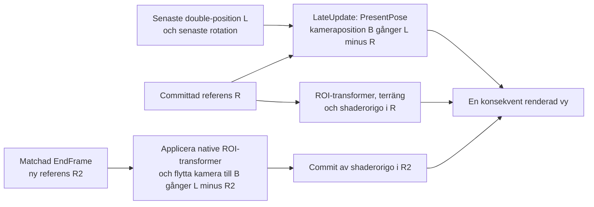

`B` är den befintliga Gizmo-till-Unity-basen, med en enda Z-reflektion.
Kameraoffseten är vyekvivalent med en gemensam korrektion på alla ROI-toppar,
men ändrar inte varje lövs transform eller terrängens texturreferens.
Vid nästa native commit byts ROI-transformer och kamerareferens tillsammans;
rörelsen får inte läggas till en gång till. Ingen SDK-graf läses och inget
SDK-lås tas av `PresentPose`. Kartbyte nollställer den gamla kamerareferensen.

Ägandet av bufferten håller kommandoreferenser vid liv. Det gör inte levande
SDK-noder låsfria att läsa. Nativevärden fångas fortfarande under korrekt
editaccess, medan publiceringen använder kopierade värden och ägda resurser.

### 4.1 Omni/frustum och fullbordad frame före rendering

De två valen är oberoende:

| Inställning | `false` | `true` |
| --- | --- | --- |
| `OmniView` | Native traversal använder kamerans frustum. | Native traversal och LOD-val åt alla håll, som CSWUnreals Omni-val. Unity gör fortfarande sin egen renderculling. |
| `SynchronizeFrames` | Budgeterad pump i Update; senaste önskade pose kan ligga före native-framen. | Pump och snapshot i LateUpdate; matchad frame fullbordas och dess pose/projektion presenteras. |

Båda ligger i värdens `Settings` och kan ändras i runtime. `OmniView` är
**true som standard**, som i CSWUnreal; `SynchronizeFrames` är false.

Med frustumtraversal laddar och aktiverar native bara kartan inom
SceneManager-kamerans frustum. Mätt på Stensholm före borttagningen av
legacy-lanet (150 m höjd, 60 °/s sväng, observatör ovanifrån med 1000 m radie
runt kameran):

| Lane | Läge | Huvudvy, max hålpixlar | Observatör, max hålpixlar |
| --- | --- | --- | --- |
| Legacy | Frustum | 0 | ~51 000 |
| Command | Frustum | ~53 000 vid sväng, ~30 % av marken | ~52 000 |
| Legacy och command | Omni | 0 | 0 |

Det borttagna legacy-lanet traverserade synkront i samma frame och fyllde
därför huvudvyn, men kartan bakom och bredvid kameran saknades ändå i
Scene-vyn och i andra kameror. Command lane är asynkron: den presenterade
kameran ligger före native-framen, så en sväng visar områden som ännu inte
aktiverats. Omni gav 0 hål även vid 360 °/s.
Omni kostar mer traversal-/byggarbete (~5 100 → ~7 800 meshar vid start) och
ersätter inte synkronisering.

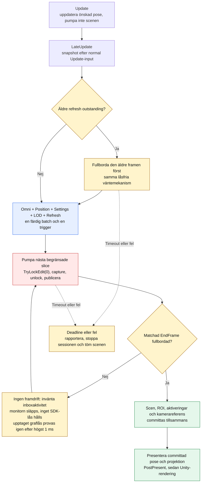

Slicarnas låsgränser är oförändrade, men flera slicar körs i **samma**
Unity-frame. Den vanliga totalbudgeten får alltså överskridas. Ingen ny
refresh skickas innan den äldre är fullbordad. Pumpen stannar vid målets
`EndFrame`, även om senare kommandon redan finns i bufferten.
`FrameWaitTimeout` på managern är fem sekunder som standard. Deadline kontrolleras
mellan operationer; ett enskilt bygge och livscykelcleanup kan inte avbrytas mitt
i arbetet. En timeout rapporteras som fel och tömmer presentationen, inte som
en framgångsrik partiell frame.

Kameran står i noll relativt den committade globala referensen och använder
just den framens rotation och perspektivprojektion. Ny input lagras separat.
Före vald kameras rendering återappliceras samma pose/projektion, både i
Built-in och vid SRP:s begin-camera-render. Ett manuellt renderanrop före
LateUpdate visar därför föregående **fullbordade** frame. Renderhooken skickar
ingen extra refresh och tar inget SDK-graflås. Avstängning av synkläget,
kartbyte och stopp släpper projektionens tillfälliga override.

Detta löser skillnaden mellan renderfrustum och den frame vars aktiveringar
har publicerats. **EndFrame betyder inte att alla asynkrona kartladdningar är
klara.** Synkläget kan ge extra latens eller bildtidssteg; det är ingen
60-fps-garanti. Se även [integrationsguidens inställningar](../howto/integrate-into-host-project.md#choose-native-coverage-and-frame-synchronization-independently).

## 5. Geometri: används samma builders och factories?

**Delvis, inte samma fullständiga byggkontrakt.**

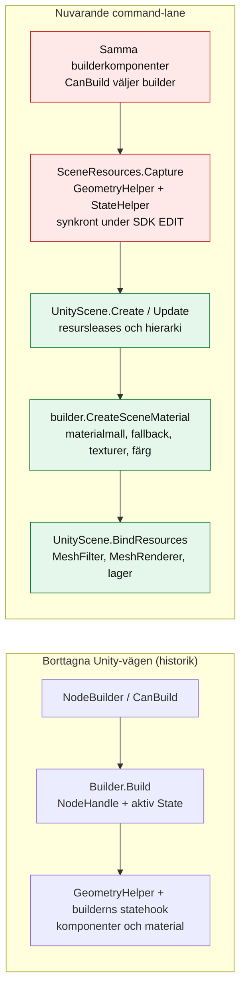

- **Återanvänds:** builderval via `CanBuild`, intersectionmask, featuretyp,
  lager, material- och fallbackmallar samt de gemensamma exporthjälparna.
- **Borttagna med legacy-lanet:** gamla `Build(...)`,
  `CreateStateNodeResources`, `CreateMaterialFromState`, `InitPoolObject`,
  `BuiltObjectReturnedToPool` och `Priority`. Egna overrides av dessa har ingen
  motsvarighet i command-vägen. Pumpens budget styrs av värdens
  `MaximumCommandsPerTick` och `Settings.MaxBuildTime`.

CSWUnreal har en registrerad factorykedja per native nodtyp med bland annat
`preBuildReference`, `updateReference`, `newObject` och enginekomponentens
`build/update/destroy`. Den fullständiga motsvarigheten finns **inte** i den här
Unity-adaptern. Att återställa ett gemensamt utbyggbart builder-/factorykontrakt
är en separat arkitekturfråga, inte något låsändringen redan löser.

Resurspubliceringen använder index över förekomster som delar meshkälla eller
statekälla. En uppdaterad delad textur inkluderar även berörda statekällor.
Orelaterade scenförekomster skannas inte vid varje geometripublicering.
Alla berörda konsumenter avnotifieras före generationsbytet, ersättningsleases
binds innan gamla resurser pensioneras och poolning tar bort indexmedlemskapet.

## 6. Exakta låsgränser och kvarvarande diskussionspunkter

| Moment | SDK-lås på anropande tråd | Viktig gräns |
| --- | --- | --- |
| Köa Omni/kamera/settings/LOD/refresh | Inget | Kort native inputkölås och objektspecifik referenssynkronisering; bufferten är färdig före triggern. |
| Behålla/frigöra buffer-/kommandoreferens | Inget | `gzThreadSafeReference` använder ett objektspecifikt mutex, inte grafens globala lås. Grafbärande innehåll kräver separat access. |
| Native väntar på inputevent | Inget | Worker väntar, inte Unity-huvudtråden. |
| Native kameramutation | EDIT | I respektive native operation efter att inputkölåset pausats. |
| Native traversal / frameproduktion | RENDER | Släpps innan framebufferten köas för output. |
| Outputcallback | EDIT, lånat från avsändaren | Bara behåll/enqueue; inget Unity-bygge. |
| Pollning av managed inbox | Inget eget SDK-lås | Kort lokalt inboxlås; släpps före SDK-låsförsöket. |
| Iterera och fånga output | EDIT via `TryLockEdit(0)` | Ingen väntetid; ingen låsning över Unity-framegränsen. |
| Synkront resursbygge i Capture | EDIT | Mesh-export, MeshData/meshbygge och state-/texturarbete kan göra låshållningen lång. |
| Hierarki, bindning, materialinstans och framecommit | Inget | Sker efter capture-slicens unlock. |
| Kamerans renderpose i LateUpdate | Inget | Asynkront: senaste pose relativt committad referens. Synkront: bara committad pose/projektion; före PostPresent. |
| Synklägets väntan på frame/inbox | Inget | Monitor.Wait släpper inboxlåset; ingen SDK-access hålls under väntan. |
| Frigöra tom outputbuffert | Redan hållet EDIT | Native `EDIT_LOCK`-cleanup behöver inte förvärva låset på nytt efter unlock. |
| Startup, byte av karta, fault och stop | Kan vänta | Native Shutdown utanför SDK-lås, sedan ägd cleanup under editaccess. |

Att diskutera med bilderna framför oss:

1. Var går den minsta säkra gränsen mellan native Capture och Unity-bygge?
   `TryLockEdit(0)` tar bort huvudtrådens låsväntan men kortar inte automatiskt
   själva mesh-/texturarbetet under låset.
2. Vilket builder-/factorykontrakt ska Unity-vägen erbjuda, inklusive egna
   builders och deras livscykel?
3. Hur mycket arbete ska en slice innehålla innan andra SDK-trådar släpps fram?
   Kommandobudget, tidsbudget och kostnaden för ett enskilt bygge är olika saker.
4. Ska alla outputkategorier använda editaccess? Unity-pumpen gör det i dag.
   CSWUnreal behandlar rena felbuffertar utan SDK-lås.

Dokumentet beskriver ingen ny cullingfunktion, ingen ny geometribyggtråd och
lovar inte en generell bildfrekvensvinst. Profiler-markörerna `CSW-Tick`,
`CSW-Capture`, `CSW-Publish`, `CSW-PublishResources` och `CSW-CommitFrame`
skiljer pumpens kostnader från rendering och avsiktlig FPS-väntan.

## 7. Unitys bildväntan ligger utanför SDK-loopen

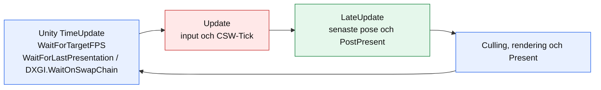

Ett långt bildintervall är inte automatiskt ett långt `CSW-Tick`.
Full CPU-profilering kan till exempel placera väntan i
`TimeUpdate.WaitForLastPresentationAndUpdateTime` och
`DXGI.WaitOnSwapChain`, även med VSync av. Det är en annan väntmekanism än
GizmoSDK:s EDIT-/RENDER-lås. Inget graflås från pumpen hålls genom nästa
Unity-frame eller dess presentationsväntan.

VSync, applikationens FPS-begränsning och Windows swapchain-modell måste därför
rapporteras tillsammans med scen-/byggkostnaderna. En okapad körning visar
arbetsmarginal men bevisar inte bildkadensen på skärmen. Applikationen äger
dessa presentationsinställningar; command-lane ändrar dem inte.
VSync på är inte heller ett bevis för att enstaka långa presentationsväntor
har försvunnit; varje sådan körning måste fortfarande mätas.

En callback från en fönsterinsamling är inte heller ett bevis för en ny visad
bild. En sådan observatör måste kontrolleras med monotona bild-ID:n, inklusive
en fristående kontroll utan CSW. Tappade, upprepade eller bakåtgående ID:n
ska redovisas, inte sorteras bort. Samma avvikelse i native kontrollprogram
och Unity räcker inte för att tillskriva felet SDK-loopen eller för att
godkänna fysisk skärmkadens.

### Fångad presentationsväntan: signal, inte huvudtrådstimeout

En ny körning med den shutdown-säkra SDK-kohorten fångade en verklig
512,924-ms-frame under ren rotation på fast position, utan debugger.
Råprofilen och processlokal Win32-loggning visar samma intervall:

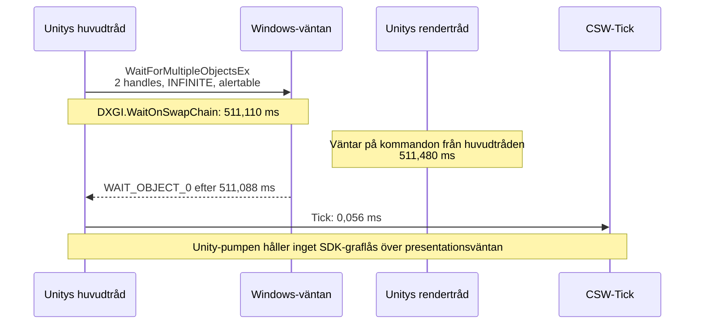

Det är alltså inte belagt att huvudtråden gör en 500-ms-timeout. Anropets
timeout är `INFINITE` och resultatet är signal, inte `WAIT_TIMEOUT`.
Rendertrådens långa frame är inte heller liktydig med tung rendering:
nästan hela intervallet ligger i `Gfx.WaitForGfxCommandsFromMainThread`.
Vilken komponent som fördröjer presentationssignalen är ännu inte fastställt.

Matchande publika Unity-symboler identifierar anropsstället som
`SwapChainWaitingContext::WaitOnSwapChain+0xf1`. Läsning av samma oförändrade
UnityPlayer-binary och kontroll mot installerad DXGI-ABI visar att första
handle kommer från `IDXGISwapChain2::GetFrameLatencyWaitableObject`.
`WAIT_OBJECT_0` väljer alltså **DXGIs frame-latency-event**, inte det andra
event som Unity använder för att avbryta väntan. Det identifierar eventet,
men förklarar ännu inte varför signalen kommer sent.

Den privata observatören ändrar inte väntans argument eller returvärden,
behåller `GetLastError` och skriver först efter mätscenariot. Den laddas
från den privata testproben; Unitys exe, UnityPlayer och SDK-/CSW-DLL:erna
är oförändrade. Loggens täckning är UnityPlayers fem importerade Win32-
väntfunktioner, inte alla väntmekanismer i Windows eller drivrutinen.

Vid denna fångst gav inputskrivbordet `ERROR_ACCESS_DENIED`; Windows egen
sessionsfråga rapporterade låst session. Separata flip-kontroller där Win32
rapporterade synligt fönster utan cloaking gav noll räknade visade bilder i både
`GetFrameStatistics` och `GetFrameStatisticsMedia`, trots stigande
present-ID:n. Det blockerar godkännande av fysisk bildkadens. Det bevisar
inte i sig att skrivbordslåset orsakar just denna väntan, och får inte
användas för att förklara bort äldre spikar utan motsvarande kontext.

### Läsande diagnostik på Unitys befintliga rendertråd

Den installerade Unity-versionen har `GetSwapChain`, `GetSyncInterval` och
`GetPresentFlags` i `IUnityGraphicsD3D11`. En separat privat diagnostikplugin
kan därför läsa **appens riktiga swapchain** via stödd native-API, utan
gissade privata objektpekare, COM-vtablehookar eller en ny geometribyggtråd.

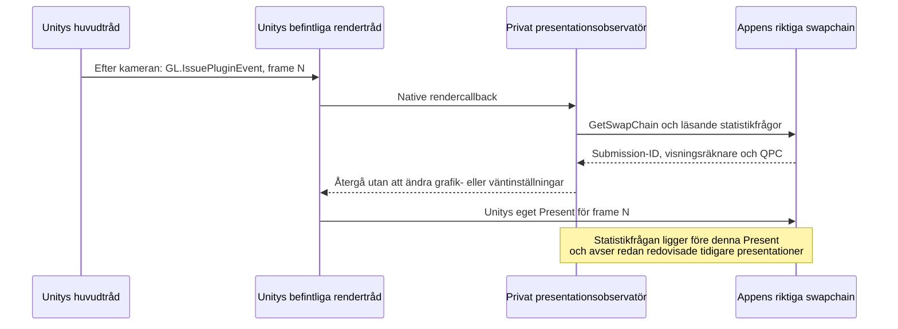

Observatören loggar både `GetFrameStatistics` och
`GetFrameStatisticsMedia`, faktiska sync-/presentflaggor, fönsteridentitet
och frågornas varaktighet. Resultat och HRESULT behålls även när räknarna
är noll eller en statistikfunktion inte är tillgänglig. Data buffras i
minne och skrivs efter mätningen; inga SDK-graflås tas.

En fristående D3D11-kontroll jämför samma frågor med sina egna anrop för
VSync 1, VSync 2 och en avsiktlig 150-ms-lucka. En verklig kartkörning
verifierar att Unity-callbackarna kör på rendertråden, inte huvudtråden.
**Noll visningsräknare i den låsta sessionen är fortfarande ingen godkänd
bildkadens**, även när faktiska submission-ID:n stiger och syncintervallet
är 1. Observatören ändrar inte pacing för att få ett bättre resultat.

Den senaste 120-sekunderskörningen gav 7 200 rotationsintervall med helt
fast global position, inga hållna kameraposer och inga intervall över
25 ms. CPU-intervallens p99/max var 16,8789/20,1642 ms. Samtidigt lästes
7 444 native samples på appens rendertråd, med faktiskt syncintervall 1,
två swapchainbuffertar och maximum latency 2. DXGI-frågornas p99/max var
0,0179/0,1226 ms; dessa tider omfattar inte Unitys accessorer, ködispatch
eller efterföljande Present. Visningsräknarna var fortfarande noll.
**En ren senare körning upphäver inte tidigare 33- och 512-ms-stopp och
godkänner inte kontinuerliga 60 visade fps.**

## 8. SDK-shutdown: inget globalt EDIT över en blockerande join

Ett separat stoppfel fångades efter clear/reload av den riktiga kartan.
`TheGizmoManager::shutdown` behöll sitt globala EDIT-lås när huvudtråden
väntade på `gzThreadNodeDeallocator::stopDeallocator`. Deallocatortråden
förstörde samtidigt en `gzDynamicLoader` vars `releasePendingLoads` behövde
samma EDIT-lås:

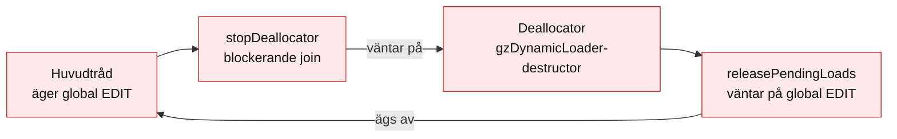

Korrigeringen ligger i GizmoSDK, inte i Unitys buffertpollning. Vanlig
SDK-cleanup och slutlig static-reference-cleanup behåller editaccess, men
de två blockerande deallocator-joinsen ligger mellan dessa scopes:

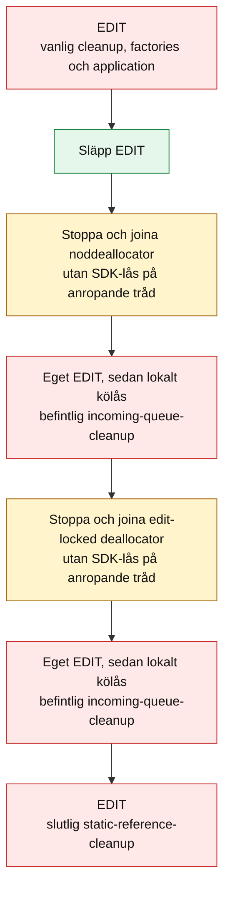

Varje kö-cleanup släpper sina lås innan nästa steg. Deallocatortrådarna kan
därmed få editaccess medan huvudtråden väntar på deras avslut. Befintlig
teardownordning och kösemantik är bevarade; detta inför inte ett nytt generellt
löfte om tömning av alla native köer.

**Anroparen får inte själv hålla EDIT eller RENDER över shutdown.** Ett
inre upplåst scope kan inte släppa ett yttre anroparlås. Kartbyte och stop är
fortfarande synkrona livscykeloperationer, inte tidsbudgeterade Tick-slices.

Den permanenta native regressionen styr factory-cleanup och loaderdestruktion
med event, anropar den riktiga `releasePendingLoads` och kräver att hela
library-shutdown återvänder. Gamla SDK-bytes ger den avsedda deadlocken;
fixade bytes passerar. Det är ett annat fel än den tidigare loader-poolens
kölås, CSW-kommandonas referensräkning och Unitys DXGI-presentationsväntan.
Den separata [shutdown-säkra beroendekohorten](../howto/stage-nuget-dependencies.md#shutdown-safe-sdk-handoff)
måste användas för att få denna SDK-korrigering.

## Källor i denna arbetskopia

| Kod | Läs särskilt |
| --- | --- |
| [CswMapStreamerHost](../../com.saab.map-streamer/Runtime/Saab.Foundation.Unity/Saab.Foundation.Unity.MapStreamer/Csw/CswMapStreamerHost.cs) | `Update`, `LateUpdate`, start och stop. |
| [MapManager](../../com.saab.map-streamer/Runtime/Saab.Foundation.Unity/Saab.Foundation.Unity.MapStreamer/Csw/MapManager.cs) | `Tick`, `HandleFrame`, `StopSession`. |
| [Inbox och native session](../../com.saab.map-streamer/Runtime/Saab.Foundation.Unity/Saab.Foundation.Unity.MapStreamer/Csw/SceneCommandInbox.cs) | `Receive`, `TryDequeue`, `SubmitFrame`, `Dispose`. |
| [SceneCommandPump](../../com.saab.map-streamer/Runtime/Saab.Foundation.Unity/Saab.Foundation.Unity.MapStreamer/Csw/SceneCommandPump.cs) | `Pump`, `CanDeferPublication`, `CaptureNode`, `Publish`. |
| [SceneResources](../../com.saab.map-streamer/Runtime/Saab.Foundation.Unity/Saab.Foundation.Unity.MapStreamer/Csw/SceneResources.cs) | `Capture`, `Publish`, `Acquire` och leasefrigöring. |
| [UnityScene](../../com.saab.map-streamer/Runtime/Saab.Foundation.Unity/Saab.Foundation.Unity.MapStreamer/Csw/UnityScene.cs) | `Create`, `Update`, `BindResources`, `CommitFrame`. |
| [GeometryBuilder](../../com.saab.map-streamer/Runtime/Saab.Foundation.Unity/Saab.Foundation.Unity.MapStreamer/GeometryBuilder.cs) | `CanBuild`, materialmallar och `CreateSceneMaterial`. |

Native referens: CSWUnreals `cswScene.cpp` (`fetchBuffers`,
`processPendingBuffers`, buffertprocessorerna och `processFrames`) samt CSW:s
`cswCommandBuffer.cpp` och `cswSceneManager.cpp` för vidareanrop, kölås och event.
