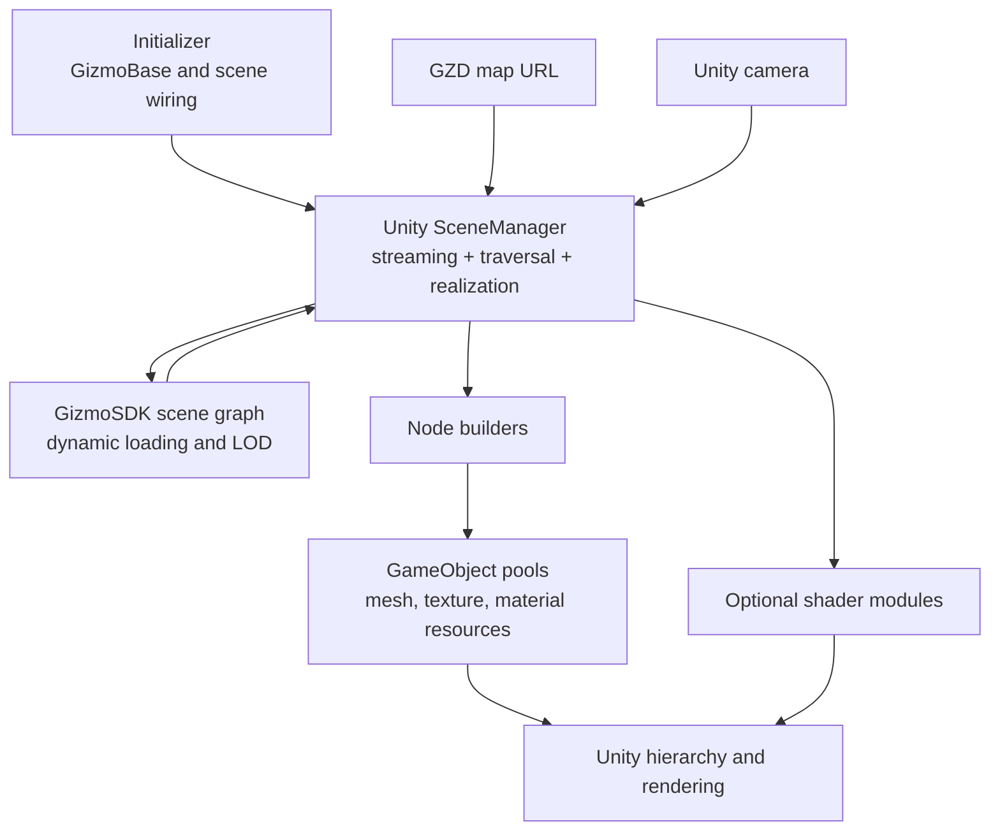

# Removed legacy architecture

**Status:** Historical. Removed in 5.0; the code links refer to commit
[`53751d5`](https://saab.ghe.com/saab/CSWUnity/tree/53751d5cd83cd95efa532a141d5339322dda1a86),
the last commit that contained it.

## Purpose

This document records the Unity-owned streaming architecture that this
repository implemented before `CswMapStreamerHost` became its only streaming
lane. It remains as migration input: it identifies proven patterns to retain
and responsibilities that move to the C# CSW SceneManager.

See [Next-generation architecture](next-generation-architecture.md) for the
implemented replacement and the target architecture.

## Runtime composition

The former
[`SceneManager`](https://saab.ghe.com/saab/CSWUnity/blob/53751d5cd83cd95efa532a141d5339322dda1a86/com.saab.map-streamer/Runtime/Saab.Foundation.Unity/Saab.Foundation.Unity.MapStreamer/SceneManager.cs)
was a Saab Unity implementation that combined:

- Gizmo3D scene, camera, context, traversal, and dynamic-loader ownership;
- direct GZD loading through `GizmoSDK.Gizmo3D.DbManager`;
- GizmoSDK scene traversal;
- Unity hierarchy creation and updates;
- node-builder selection and scheduling;
- Unity object pooling;
- texture and material resource management;
- frame traversal and camera synchronization; and
- map and native resource shutdown.

[`Initializer`](https://saab.ghe.com/saab/CSWUnity/blob/53751d5cd83cd95efa532a141d5339322dda1a86/com.saab.map-streamer/Runtime/Saab.Unity/Saab.Unity.Initializer/Initializer.cs)
initialized GizmoBase, configured diagnostics and registries, located the
`SceneManager` and camera control, and connected them before
`SceneManager.Start()` initialized streaming.

## Builder and factory pattern

[`INodeBuilder`](https://saab.ghe.com/saab/CSWUnity/blob/53751d5cd83cd95efa532a141d5339322dda1a86/com.saab.map-streamer/Runtime/Saab.Foundation.Unity/Saab.Foundation.Unity.MapStreamer/NodeBuilder.cs)
defined the legacy realization contract:

- `CanBuild` selected a builder for a native GizmoSDK node and traversal state;
- `Build` realized the node into a pooled `NodeHandle`;
- `InitPoolObject` decorated the pool prototype;
- `BuiltObjectReturnedToPool` released or detached resources;
- `Priority` selected immediate or deferred work; and
- texture and material managers were injected as shared services.

`SceneManager` registered builders before initialization and selected the first
builder whose `CanBuild` method succeeded. Deferred builds retained the
`NodeHandle` generation so stale work could be rejected after recycling.

The geometry builders were:

- [`TerrainNodeBuilder`](https://saab.ghe.com/saab/CSWUnity/blob/53751d5cd83cd95efa532a141d5339322dda1a86/com.saab.map-streamer/Runtime/Saab.Foundation.Unity/Saab.Foundation.Unity.MapStreamer/TerrainNodeBuilder.cs)
  for terrain geometry and terrain state;
- [`AssetNodeBuilder`](https://saab.ghe.com/saab/CSWUnity/blob/53751d5cd83cd95efa532a141d5339322dda1a86/com.saab.map-streamer/Runtime/Saab.Foundation.Unity/Saab.Foundation.Unity.MapStreamer/AssetNodeBuilder.cs)
  for static asset geometry; and
- the internal
  [`AssetInstanceBuilder`](https://saab.ghe.com/saab/CSWUnity/blob/53751d5cd83cd95efa532a141d5339322dda1a86/com.saab.map-streamer/Runtime/Saab.Foundation.Unity/Saab.Foundation.Unity.MapStreamer/AssetInstanceBuilder.cs)
  for sharing prefab mesh and material resources across GizmoSDK reference-node
  instances.

This was a builder/factory design even though selection and object allocation
were implemented directly by `SceneManager`.

## Pooling and resources

The implementation reduced runtime allocation through:

- a pool per `PoolObjectFeature`;
- builder-specific inactive GameObject prototypes;
- time-sliced background pre-allocation;
- deferred hierarchy release;
- generation checks that invalidate stale deferred builds;
- shared, reference-counted textures and materials;
- recycled `Texture2D` objects with a bounded cache; and
- reusable geometry conversion buffers.

[`TextureManager`](https://saab.ghe.com/saab/CSWUnity/blob/53751d5cd83cd95efa532a141d5339322dda1a86/com.saab.map-streamer/Runtime/Saab.Foundation.Unity/Saab.Foundation.Unity.MapStreamer/TextureManager.cs)
and
[`MaterialManager`](https://saab.ghe.com/saab/CSWUnity/blob/53751d5cd83cd95efa532a141d5339322dda1a86/com.saab.map-streamer/Runtime/Saab.Foundation.Unity/Saab.Foundation.Unity.MapStreamer/MaterialManager.cs)
were owned by `SceneManager` and shared by builders.

## Optional shader and GPU modules

The example scene demonstrated optional modules attached beside the core
`SceneManager`:

- `MapShadingModule` added classified terrain detail textures and normals
  through texture arrays and a feature mapping buffer.
- `FoliageModule` generated and culled foliage on the GPU and rendered it with
  indirect procedural draws.
- `CameraShaderUpdater` supplied camera-relative shader offset and Local Tangent
  Frame basis
  values required by shaders.

The modules subscribed to `SceneManager` events such as `OnNewTerrain`,
`OnRemoveTerrain`, and `OnPostTraverse`. Their activation combined Inspector
state, `GfxCaps` flags, `KeyDatabase` settings, materials, ScriptableObject
asset sets, shaders, and compute shaders.

This proved that shader functionality can be layered on top of streamed
terrain, but the activation and dependency contract was not a formal module
API.

## Patterns to retain

- Builder/factory separation between scene interpretation and Unity resource
  creation.
- Immediate and deferred realization with stale-work detection.
- Pooling and reference-counted resource reuse.
- Asset-instance sharing.
- Optional shader functionality connected through lifecycle events.
- GPU-driven terrain and foliage processing.
- Camera-relative shader data for large geospatial coordinates.
- Explicit time budgets and profiler markers.

## Responsibilities to move or separate

- Gizmo scene ownership, map lifecycle, traversal, dynamic loading, and frame
  production move to C# CSW SceneManager.
- Unity realization consumes typed CSW buffers instead of traversing the
  mutable native scene directly.
- Runtime composition uses explicit references and configuration assets rather
  than scene-wide `FindObjectOfType` calls.
- Builder registration, feature activation, fallback behavior, and capability
  reporting become formal contracts.
- Optional shader modules no longer depend on unrelated global capability
  state.
- Thread transfer, buffer ownership, queue bounds, and frame commit become
  explicit.

## Known migration considerations

- Legacy builders accepted `GizmoSDK.Gizmo3D.Node` and `NodeHandle`; target
  builders need a format-neutral scene payload and a stable instance identity.
- The legacy `SceneManager` owned both streaming and pools. The target splits
  those lifetimes between CSW SceneManager and CSWUnity realization services.
- Current resource caches are valuable but need content-stable keys,
  measurable limits, and a documented lease model.
- Current terrain and foliage modules depend on specific shader properties and
  event timing; adapters or revised module contracts are required.
- Legacy crossboard and standalone culling components should not define the
  target architecture unless a supported feature still depends on them.
