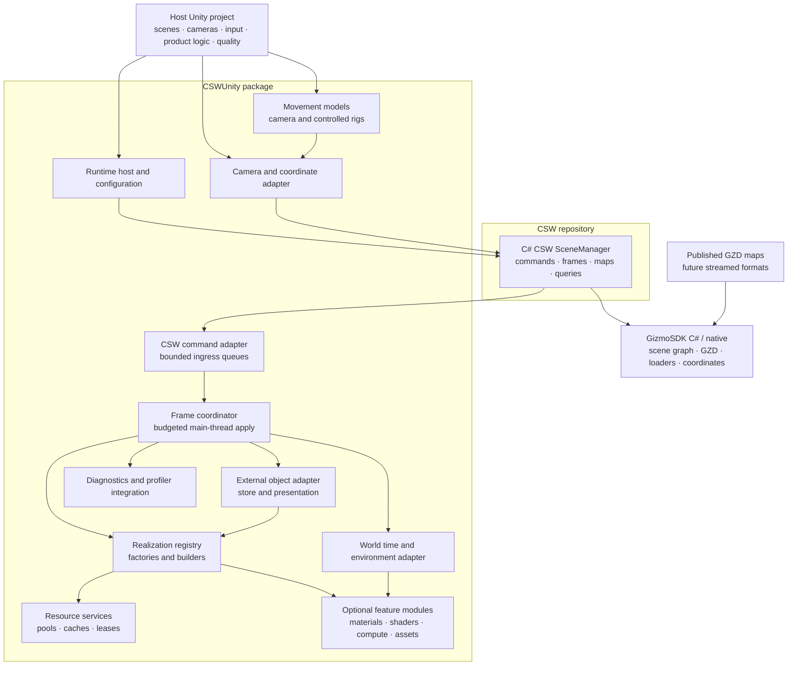
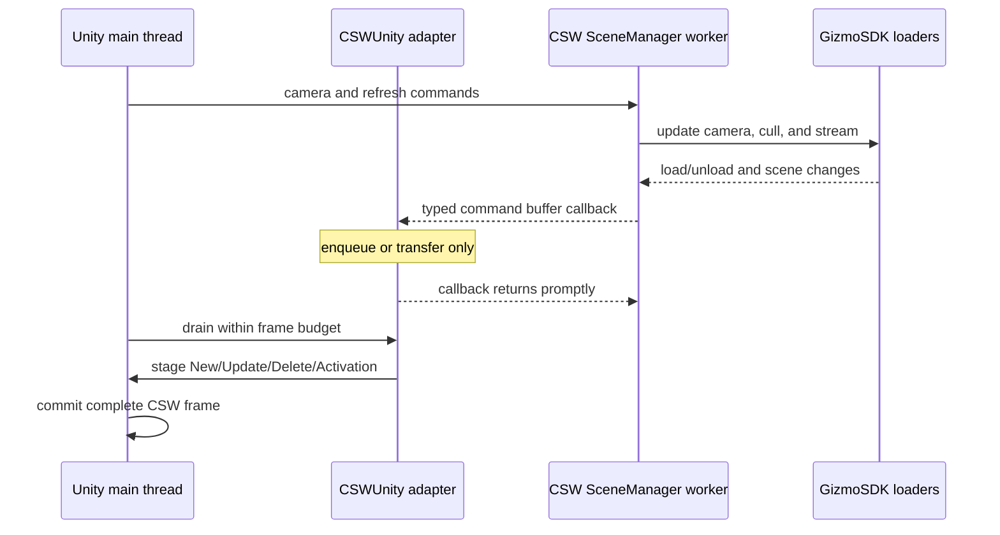
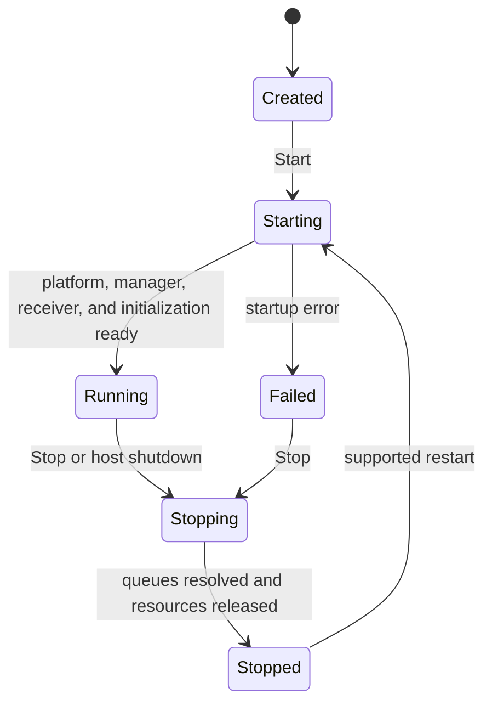

# Next-generation architecture

**Status:** Phase 1 command-driven consumer implemented as an opt-in lane;
the broader target architecture below remains incremental.

## Phase 1 implementation

The existing package now contains the parallel runtime in
`Saab.Foundation.Unity.MapStreamer.Csw`. The legacy `SceneManager` remains
available and the example scene still defaults to that lane.

| Concrete component | Phase 1 responsibility |
| --- | --- |
| `CswMapStreamerHost` | Explicit scene composition, platform lifetime, camera/input and optional module injection |
| `MapManager` / internal session | Native manager/receiver ownership, map lifecycle, input submission and refresh backpressure |
| `SceneCommandInbox` | Ordered ownership transfer from the native callback, bounded normal ingress and explicit overload failure |
| `SceneCommandPump` | Edit-locked capture, bounded main-thread realization and correlated frame completion |
| `UnityScene` | Occurrence hierarchy, presentation gates, pooling, resource leases and module notifications |
| `SceneCoordinateContext` / `CameraBridge` | Typed CRS conversion, double global pose, camera-relative root transforms and committed shader parameters |

This is a presentation consumer, not a second traversal or loading engine.
The native manager continues to select maps, ROI/LOD, scope and streamed
content. Camera movement does not trigger a consumer-side full-subtree refresh.
The example and other host projects explicitly select their builders and
optional terrain/foliage components; no scene-wide dependency discovery is used.
See [host integration](../howto/integrate-into-host-project.md) for the actual
composition and lifecycle API.

Phase 1 requires an identity **world** transform on the scene attachment
parent. This is validated before owned objects are created and at frame commit.
The Unity camera remains at world `(0,0,0)`; flight changes a double global
native pose, and native ROI/toptransform updates move the map hierarchy.
Raw vertices and native local matrices are preserved beneath one reflected
root, so the world transform is `B * parent * child * rawVertex`, with
`B = diag(1,1,-1)`. The frame's copied pose supplies shader/terrain metadata;
the latest requested pose must not be mixed with an older root transform.

Advanced spatial-query/navigation services, external-object transport,
world/environment contracts, Jobs/Burst realization and broad renderer or
platform parity are not Phase 1 deliverables. The target sections describing
those services are not a claim that corresponding public runtime APIs exist.

### Phase 1 regression fixtures

`CswSceneCommandTests` exercises ordered ownership, exact occurrence/parent
identity, partial-buffer budgets, frame correlation, stale lifetime rejection
and failure cleanup in EditMode. `CswSceneResourceTests` and
`CswPresentationModuleTests` require a graphics-enabled PlayMode runner; they
cover actual native texture mutation/old leases, module reinjection, GPU
scope counters, and asymmetric rendering/backface/world-normal behavior with
the existing shaders.

`CswNativeMapTests` accepts a published GZD URL through `CSWUNITY_TEST_MAP`.
It compares rendered pixels with an actual empty-camera capture, moves and
rotates the double camera pose, sustains correlated refreshes, leaves and
re-enters native scope, and clears/reloads before stopping. The combined
negative/positive run forces collection **after** positive initialization and
again during flight, so delayed callback cleanup from an earlier platform
lifetime cannot silently disable the current receiver.

The scope excursion follows the typed map-local up direction, preserving a
projected CRS's horizontal domain. Mesh-retention assertions compare the full
occurrence key and actual Mesh identity, including surviving LOD-Off branches;
native asynchronous LOD refinement can replace the entire visible coarse set.

Optionally set `CSWUNITY_TEST_SCENE` to a Unity asset path in the validation
project, for example `Assets/Scenes/ExampleScene.unity`. That uses the shipped
scene's actual serialized composition and removes its disabled legacy
components only in the running test; neither the source scene nor its opt-in
default is changed. `CSWUNITY_TEST_ARTIFACTS` selects an external screenshot
directory. Fixture URLs, machine paths and runtime output are not source
configuration defaults. Use the Windows x64 dependency profile and D3D11
PlayMode validation, not a no-graphics runner for the GPU/resource fixtures.

## Context

The next generation of CSWUnity shall follow the same separation used by the
C++ CSW SceneManager and CSWUnreal:

1. an engine-neutral CSW SceneManager owns streaming and emits typed commands;
2. an engine-specific adapter receives those commands; and
3. engine-specific factories realize scene content under the engine's
   threading and resource rules.

For Unity, the reusable core is the
[C# CSW SceneManager](https://saab.ghe.com/saab/CSW/tree/main/source/Presentation/Streaming/C%23).
The
[C++ SceneManager and CSWUnreal](https://saab.ghe.com/saab/CSW/tree/main/source/Presentation/Streaming)
are the behavioral reference.

The Phase 1 managed structural, transform, activation, frame, geographic and
error bindings are supplied by the matching local SceneManager package pair
pinned in the locked staging graph. SDK/Distribution pins remain unchanged.
The [dependency staging guide](../howto/stage-nuget-dependencies.md) documents
the unpublished pair and cold-restore/bootstrap requirements. Query and other
future capabilities must be validated separately before replacing the current
Unity `SceneManager` for applications that depend on them.

The new generation is named **CSW Map Streamer**, with
`csw-map-streamer` used as its technical working name. Existing
`com.saab.map-streamer` package identifiers and serialized references remain
in place during an incremental compatibility migration.

## Goals

- Provide reusable Unity components and assets for arbitrary host projects.
- Keep CSW SceneManager independent of Unity.
- Preserve CSWUnreal command, frame, coordinate, and lifecycle principles.
- Support GZD first without making Unity realization GZD-specific.
- Sustain high streaming throughput with bounded main-thread work.
- Retain proven builder, pooling, resource-sharing, and optional shader
  patterns.
- Integrate external world objects through a transport-neutral object model.
- Realize CSW world time and environment capabilities through optional Unity
  modules.
- Provide interchangeable camera and movement models.

## Non-goals

- Generate maps or source assets.
- Move product-specific input, UI, or simulation behavior into CSWUnity.
- Copy Unreal component types, material conventions, or C++ ownership into C#.
- Allow background workers to invoke unrestricted Unity APIs.

## Layered architecture



## Responsibility boundaries

| Layer | Responsibilities |
| --- | --- |
| Host project | Unity scenes, camera selection, input, product lifecycle, render-pipeline choice, deployment, and quality profile |
| CSWUnity runtime host | Configuration, lifecycle state, dependency validation, and coordination |
| CSW command adapter | Receiver registration, bounded transfer, buffer decoding or leasing, ordering, and ownership |
| Frame coordinator | Main-thread scheduling, frame staging/commit, hierarchy ordering, and budgets |
| Realization registry | Deterministic factory selection and feature fallback |
| Builders/realizers | Create, update, activate, deactivate, and release Unity representations |
| Resource services | Object, mesh, texture, material, and instance pooling/caching with explicit ownership |
| Object integration | Transport-neutral object state, motion presentation, and Unity presenters |
| World/environment integration | World time and semantic environment snapshots |
| Movement services | Input-independent movement models, constraints, queries, and camera/object rigs |
| Optional modules | Render-pipeline-specific weather, shaders, GPU features, foliage, terrain detail, and sensors |
| C# CSW SceneManager | Map and ROI lifecycle, scene traversal, dynamic loading, camera/frame commands, queries, and typed output buffers |
| GizmoSDK | GZD and other supported readers, native scene graph, coordinate services, serialization adapters, and low-level loading |

## Command and thread model

Detailed map, coordinate, position, intersection, asset, and scene-update
control is defined in
[Scene control and threaded realization](scene-control-and-threading.md).



The receiver callback does not build meshes, materials, textures, or
GameObjects. It enqueues the exact transferred, owned command buffer without
adding another reference. The borrowed callback manager/receiver wrappers are
not disposed. Normal ingress is bounded; overload faults the session instead
of dropping structural commands. If releasing a rejected buffer itself fails,
ownership is quarantined for retry rather than silently lost.

When a CSW buffer contains mutable native references, CSWUnity must either:

1. copy the required format-neutral data while holding the documented lock;
2. acquire an explicit payload lease valid beyond the lock; or
3. schedule a supported native-to-Unity upload path with equivalent ownership.

Owned native buffers may wait in the inbox, but payload access and owned
Node/Parent/State getter releases occur inside the edit-lock capture batch.
Only copied data and Unity resource ownership cross into publication after the
lock is released. A borrowed native pointer is an opaque identity, never a
retained handle or an unlocked source to dereference later.

## Scene protocol

The managed CSW SceneManager contract must provide:

| Category | Required semantics |
| --- | --- |
| Lifecycle | Initialize, uninitialize, completion, and failure |
| Maps | Set, add, remove, clear, source identity, and correlated result |
| Geographic context | Coordinate system, Map Origin `GeoPosition`, units, and map compatibility |
| Structure | New, update, and delete with node and parent identity |
| Visibility | Activation and deactivation, including LOD transitions |
| Frames | Start and end boundaries with ordering |
| Camera | Position, orientation, projection, viewport, LOD factor, and render time |
| Queries | Correlated intersection, ground-clamp, and position responses as enabled |
| Diagnostics | Typed severity, error code, message, source, and correlation ID |

Phase 1 occurrence identity is exactly `(native Node*, full uint64 PathID)`,
including `(Parent*, ParentPathID)` for hierarchy attachment and `(null,0)` as
the host-owned sentinel. Different nodes can legitimately share a path, and one
source node can have multiple occurrences. Paths are not compacted, truncated
or reconstructed from SDK parent lists. Session generation, occurrence lifetime
and parent version separately invalidate deferred work after clear, deletion,
identity reuse or reparenting.

## Frame staging and commit

Phase 1 consumes structural and resource commands in native order within a
main-thread item/time budget. A partially consumed buffer remains owned for the
next tick, without holding an edit lock across Unity frames. New occurrences
remain hidden until their frame is committed, even when attached beneath an
already visible map.

Transform-only updates copy the published local matrix and do not rebuild
geometry or subtrees. Frame transforms and local activation are deferred until
the matching EndFrame is consumed. The scene then commits camera/shader state,
publishes copied terrain metadata while new terrain is still hidden, and
releases presentation/visibility gates. Scope Off/On changes the map hierarchy
only; retained resources and each child's local LOD-Off state survive re-entry.

Only one refresh may be outstanding through **consumption** of its EndFrame,
not merely callback receipt or enqueue. The input command's `ID` is the fence;
StartFrame/EndFrame `RefreshID` and EndFrame `CommandRefID` must match it.
Stale generation/lifetime/parent-bound changes cannot affect replacement
occurrences.

## Realization registry and builders

Phase 1 reuses the existing geometry/state exporters, writable MeshData,
texture upload/mipmap policy, builder material templates and diagnostics.
`GeometryBuilderBase` supplies a command-lane material adapter; effective State
comes from each command rather than a reconstructed parent traversal.
Zero-mask geometry remains a structural occurrence without allocating a
renderer. A generalized format-neutral registry remains a later evolution.

A registry entry declares:

- supported scene payload type and required state;
- produced Unity representation type;
- required render-pipeline or hardware capabilities;
- cost/priority classification;
- fallback behavior; and
- optional feature dependencies.

A realizer supports:

- **Create:** allocate or obtain a pooled representation;
- **Update:** modify supported state without unnecessary replacement;
- **SetActive:** handle visibility and LOD activation;
- **Release:** return resources and objects to their owners; and
- **Reset:** clear map- or session-scoped caches.

Registration occurs before the runtime enters `Running`. Duplicate selectors
or unsupported required payloads fail validation explicitly.

## Resource architecture

Resource services are independent from individual builders:

- GameObject/component pools are keyed by representation class.
- Mesh resources are keyed by stable content or source identity and layout.
- Texture resources are keyed by content/source identity, dimensions, format,
  mip state, and color-space semantics.
- Materials are keyed by shader/profile and immutable render state.
- Shared assets and instances hold explicit leases or reference counts.
- Cache budgets and eviction are configurable and observable.

Unity object creation and destruction occurs on the main thread. CPU decoding
or conversion may use workers, jobs, Burst, and reusable native memory when
the selected Unity version supports the path.

In Phase 1, source-keyed mesh and effective-State versions have independent
leases from occurrence renderers/transforms. Compatible native texture
sources/layouts share a texture revision across different States. Updating a
shared native texture refreshes all dependent current States, while unchanged
slots retain their leases. All affected observers detach before publication;
replacement leases are acquired before previous ones are released. An
actually leased old mesh/material/texture version remains valid until its
last lease ends. This does not require cached native State/Texture/Image
wrappers or native queries from Unity modules.

## Optional shader and feature modules

Optional rendering is configured through feature profiles and serialized
assets rather than hidden global state.

The target extension points cover:

- post-create and pre-release notifications;
- resource decoration or substitution;
- post-frame GPU dispatch and drawing;
- camera and Local Origin Offset shader parameters;
- capability and render-pipeline validation; and
- per-feature diagnostics and budgets.

Phase 1 terrain detail and foliage accept an injected `IScenePresentation`
with copied metadata and the same explicit camera. Hidden-first terrain can
register resources before presentation. Foliage retains those resources across
scope Off, resets append/indirect counts when no branch is active, and suppresses
draw submission for inactive sets. Existing shaders/compute/include code and
Hi-Z timing remain unchanged.

`CameraBridge` is the command lane's `_WorldOffset`/`_LocalToEUN` writer.
The host disables its assigned `LegacyComponents` before startup, including
legacy traversal, camera and shader drivers. Other scenes must supply that
list explicitly; there is no global discovery or automatic reenable on stop.
The following table describes the broader target placement:

| Current feature | Target placement |
| --- | --- |
| `MapShadingModule` | Optional terrain-shading feature and profile |
| `FoliageModule` | Optional GPU foliage feature with explicit compute/shader dependencies |
| `CameraShaderUpdater` | Coordinate/render service shared by interested features |
| `GfxCaps` flags | Capability report plus explicit feature-profile selection |
| Terrain/Foliage ScriptableObjects | Versioned feature assets |

The common streaming package must remain usable when none of these modules is
installed.

## Source-format evolution

CSWUnity consumes a common scene protocol, not a GZD object model. GZD remains
the first production source and is loaded by GizmoSDK through CSW SceneManager.

Support for another streamed format may require changes in GizmoSDK or CSW
SceneManager, but it must not require changes to:

- CSWUnity lifecycle;
- command ingress and frame scheduling;
- stable instance identity;
- coordinate adaptation; or
- builders whose supported common payloads are unchanged.

Format-specific metadata may be exposed as optional typed extensions without
becoming mandatory for common builders.

## Package shape

The initial delivery may use one Unity package, but its assemblies and folders
must preserve boundaries that allow later package separation:

```text
Runtime/
  Core/             lifecycle, configuration, command adapter, frame scheduler
  Realization/      registry, builders, identities, resource services
  Coordinates/      camera, Local 3D Frame, and geographic adaptation
  Objects/          external object store, motion, and Unity presenters
  World/            time and environment contracts
  Movement/         input, movement models, constraints, and rigs
  Diagnostics/      logs, counters, and profiler markers
  Features/         optional feature integrations
Editor/             inspectors, validation, and authoring tools
Tests/
Samples~/
Shaders/
Resources or assets required by installed features
```

The final package identifier and optional package split remain design
decisions. Consumers depend only on public assemblies and serialized assets,
not the repository example project.

Native and managed CSW/GizmoSDK dependencies are first materialized as a
separate generated UPM package. A locked NuGet graph and an explicit platform
profile determine the package contents. The generated package records installed,
disabled, and unavailable targets and contains deterministic Unity plugin
import settings. An enabled required target fails packaging when any managed or
native dependency is missing; missing assets are never silently omitted.

This staging path is the single dependency-installation mechanism. Additional
platforms are enabled only after their complete package profiles pass Unity
import and player-build validation.

## Lifecycle



Phase 1 shutdown order is:

1. stop new submissions;
2. call native `Shutdown` outside edit access and outside the callback so the
   native worker is woken, stopped and its receiver unlinked;
3. under edit access, attempt release of every owned command, buffer and
   receiver wrapper, retaining failed ownership for retry;
4. dispose the native manager outside edit access;
5. clear Unity occurrences with their removal observers still attached, then
   detach optional presentation subscribers while their old source is still
   available and dispose the remaining scene/pool and coordinate owners;
6. release matching CSW and Coordinate platform references.

Do not call generic `Stop(true)` before `Shutdown`, or independently remove an
already unlinked receiver. Teardown attempts independent owners even when
another fails and reports aggregate errors rather than success-shaped cleanup.
Clear/reload creates a fresh native session as well as a new scene generation,
so late same-session output cannot populate the replacement map.

## Performance strategy

- Keep CSW loading and traversal off the Unity main thread.
- Bound every cross-thread queue and define overload behavior.
- Decode or lease buffers with minimal lock duration.
- Apply Unity changes under configurable time and item budgets.
- Pre-size and reuse command, instance, hierarchy, and resource storage.
- Avoid ordinary steady-state managed allocations after warm-up.
- Share immutable resources and use instancing or batching where appropriate.
- Cancel work by instance generation before performing expensive conversion.
- Instrument every queue and processing stage.

Performance approval uses a published release profile rather than an
unrepeatable statement that the system is "fast".

## Migration sequence

1. Establish locked CSW/GizmoSDK NuGet-to-UPM staging, platform capability
   reporting, and Windows x64 Unity validation.
2. Complete the C# wrappers for CSW structural, frame, geographic, error, and
   correlated response commands.
3. Build a headless managed contract test against the C# CSW SceneManager.
4. Add the CSWUnity command adapter, stable identity, and frame coordinator
   without Unity resource creation.
5. Port basic node/transform and geometry realization behind the new registry.
6. Add pooling and shared mesh, texture, material, and instance services.
7. Port camera and coordinate behavior and validate against CSWUnreal.
8. Add movement-model and asynchronous spatial-query services.
9. Add the transport-neutral external object store and Unity presenters.
10. Add world-time and environment contracts.
11. Port terrain detail and foliage and add environment realizations as
   optional modules.
12. Establish performance profiles and optimize measured bottlenecks.
13. Deprecate the current Unity-owned streaming `SceneManager` after feature and
   performance parity.

## Open decisions

- Generalizing the Phase 1 owned-buffer/edit-locked capture and copied
  main-thread publication boundary to additional payload types.
- Supported Unity versions, platforms, and render pipelines.
- Numeric release performance profiles.
- Package and assembly split for optional rendering features.
- Required initial query set beyond map, camera, and frame streaming.
- Initial environment contract fields and authoritative providers.
- Initial external-object schemas and transport adapters.

## Related documentation

- [Next-generation architecture requirements](../requirements/next-generation-architecture.md)
- [Scene control requirements](../requirements/scene-control.md)
- [Scene control and threaded realization](scene-control-and-threading.md)
- [Synthetic world](synthetic-world.md)
- [External object integration](object-integration.md)
- [Movement models](movement-models.md)
- [Rendering](rendering.md)
- [Current architecture](current-architecture.md)
- [Streaming Map pipeline](streaming-map-pipeline.md)
- [Runtime initialization](runtime-initialization.md)
