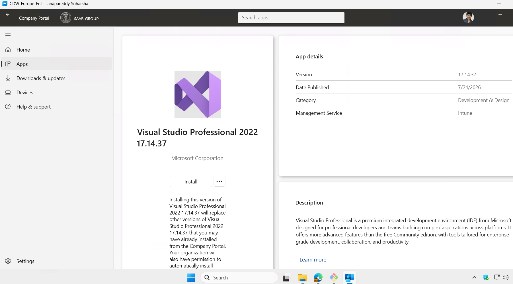
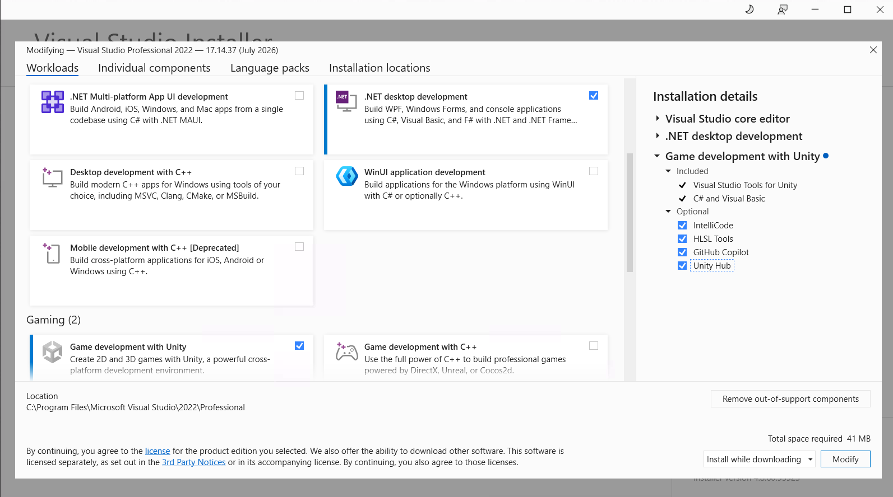

# 2. Visual Studio and .NET SDK Installation

CSWUnity no longer builds or copies GizmoSDK binaries through a Visual Studio
solution. The repository uses a .NET command-line stager to restore the locked
CSW/GizmoSDK package graph and generate a Unity dependency package.

Visual Studio remains optional for C# development and Unity debugging.

## 2.1 Install Visual Studio

1. Open the **Company Portal** application in the CDW.
2. Search for and install one of the following:
   - **Visual Studio 2022 Professional**
   - **Visual Studio 2026 Enterprise**
3. After installation is complete, restart the CDW.


*Figure: Visual Studio Professional available through the Company Portal.*


## 2.2 Install Required Workloads

1. Open **Visual Studio Installer** from the Windows Start menu.
2. Find the installed Visual Studio version.
3. Click **Modify**.
4. Keep the default selected workloads.
5. Additionally select:
   - `.NET desktop development`
   - `Game development with Unity`
6. Under **Installation Details**, select **Unity Hub** if available.
7. Click **Modify**.


*Figure: Required Visual Studio workloads and Unity-related installation options.*


This installs the tools used for CSWUnity development and Unity debugging.

## 2.3 First-Time Visual Studio Login

1. Open Visual Studio.
2. Sign in using a Microsoft or GitHub account if required.
3. Complete any authentication steps.

## 2.4 Verify the .NET SDK

Open PowerShell in the cloned CSWUnity repository and run:

```powershell
dotnet --info
```

An SDK capable of building `net8.0` tools must be listed.

The dependency package is generated with:

```bat
setup.bat
```

The complete setup and demo workflow is described in the
[Map Streamer demo guide](CDW_map_streamer_DEMO.md).
