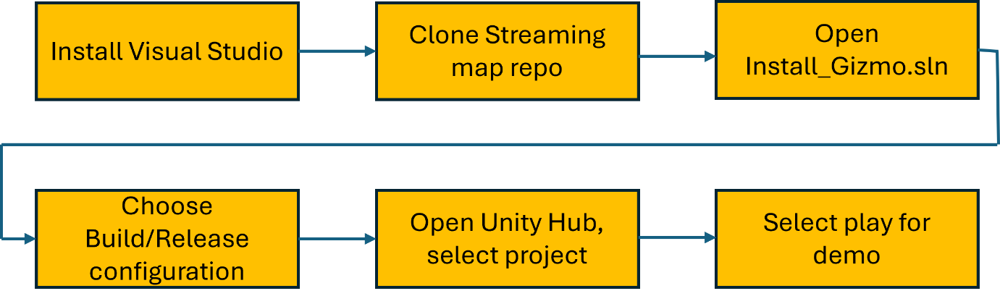
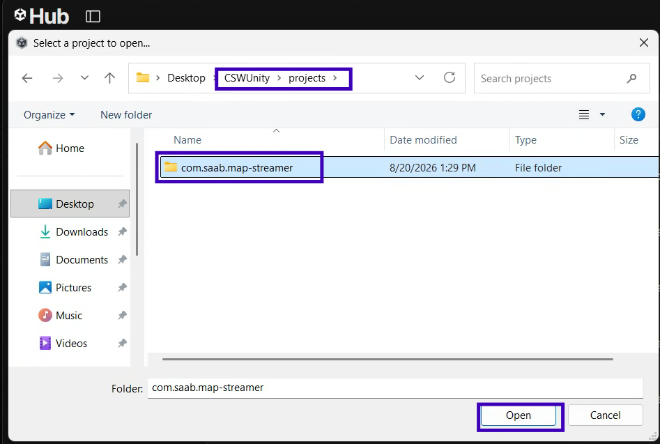
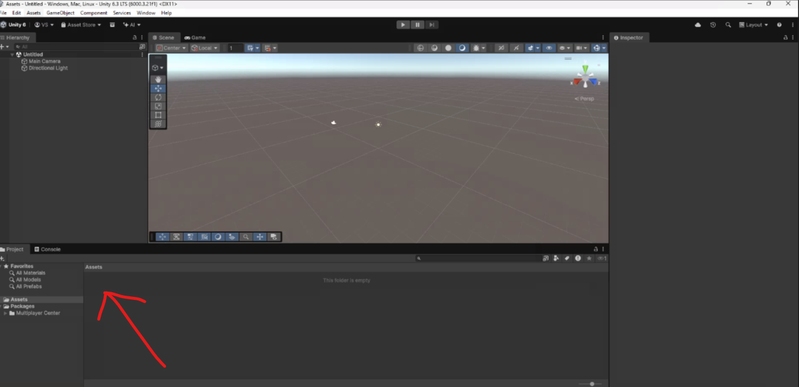
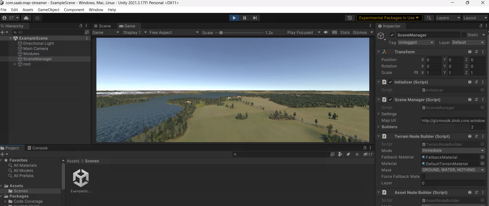

# 4. Map Streamer

This section describes the complete workflow for setting up and running the
**CSWUnity Map Streamer** demo after CDW, the .NET SDK, and Unity are installed.


*Figure: Overall Map Streamer workflow from installation and cloning through build and Unity demo execution.*


## 4.1 Install Git

1. Open the **Company Portal** application in the CDW.
2. Search for and install **Git**.
3. This installs:
   - Git Bash
   - Git CMD

## 4.2 Clone the CSWUnity Repository

1. Open a browser and go to:

   `https://saab.ghe.com`

2. Authenticate using Saab SSO.

3. Open **Git Bash**.

4. Navigate to the directory where you want to clone the repository.

5. Run:

`git clone https://saab.ghe.com/saab/CSWUnity.git`

6. Navigate into the repository:

`cd CSWUnity`

The repository contains files/folders similar to:

    CSWUnity
    │
    ├── build
    ├── README.md
    ├── projects
    ├── tools
    ├── tutorial
    └── com.saab.map-streamer

## 4.3 Open the Repository in File Explorer

From Git Bash, open the current repository folder in Windows File Explorer:

`explorer .`

Alternatively, navigate manually to the cloned `CSWUnity` folder.

## 4.4 Stage the CSW and GizmoSDK Dependencies

Open PowerShell in the repository root and run:

```powershell
dotnet run --project tools\CSWUnity.NuGetStager -- stage
```

The stager:

- restores the exact versions in
  `build\nuget-staging\packages.lock.json`;
- validates the Windows x64 managed and native dependency closure;
- generates deterministic Unity plugin import settings; and
- writes the local UPM package below
  `artifacts\unity-packages\com.saab.map-streamer.dependencies`.

The example Unity project already references this generated local package.

The current setup baseline uses:

- `CSW.SceneManager` `1.1.1.1`; and
- GizmoSDK `2.12.347.1`.

## 4.5 Verify the Generated Package

Run:

```powershell
dotnet run --project tools\CSWUnity.NuGetStager -- verify
```

Verification checks the ownership manifest, SHA-256 hashes, required managed
assemblies, required native libraries, and the configured platform status.

If a clean regeneration is needed, run:

```powershell
dotnet run --project tools\CSWUnity.NuGetStager -- clean
dotnet run --project tools\CSWUnity.NuGetStager -- stage
```

## 4.6 Add the Map Streamer Project to Unity Hub

1. Open **Unity Hub**.
2. Select **Projects**.
3. Click **Add Project From Disk**.
4. Select:

`CSWUnity/projects/com.saab.map-streamer`


*Figure: Select the com.saab.map-streamer project folder when adding the project in Unity Hub.*

> Ensure that the correct Unity project folder is selected.


*Figure: Example of an incorrectly selected project directory resulting in missing Assets.*


## 4.7 Open the Project in Unity

1. In Unity Hub, click the `com.saab.map-streamer` project.
2. Wait for Unity Editor to finish:
   - Importing assets
   - Compiling scripts
   - Resolving packages

3. In the Unity Project window, open:

`Assets -> Scenes -> ExampleScene`

4. Double-click **ExampleScene** (`Assets/Scenes/ExampleScene.unity`).

## 4.8 Run the Demo

Press the **Play (▶)** button at the top of the Unity Editor.

The streaming map should load in the scene.


*Figure: Expected Map Streamer demo output in the Unity Editor.*


## 4.9 Navigation Controls

| Key | Action |
|---|---|
| `W` | Move Forward |
| `A` | Move Left |
| `S` | Move Backward |
| `D` | Move Right |
| `Space` | Move Up |
| `Ctrl` | Move Down |
| `Arrow Keys` | Rotate Camera |
| `Shift` | Increase Movement Speed |

## 4.10 Important Dependency Note

Do not copy additional CSW or GizmoSDK DLLs into the Unity project. The staged
UPM package is the single dependency source. When package versions change,
regenerate and verify the package before reopening Unity.
